# vsts

Plugins de áudio da **InsideStudioSP**, feitos com [JUCE](https://juce.com), e devices Max for Live para o Ableton.
Loja, páginas dos produtos e manuais: [insidestudiosp.com.br](https://insidestudiosp.com.br).

| Pasta | O que tem |
|---|---|
| `plugins/criativo/<plugin>`, `plugins/mix/<plugin>`, `plugins/knob/<pedal>` | As três séries de 10 efeitos (um instalador por série) |
| `instrumentos/<nome>` | Synths e os plugins com pacote próprio (mix, master, voz, guitarra) — um instalador cada |
| `max4live/<nome>` | Devices Max for Live (VASSOURA, RODO, ESPANADOR) |
| `licenca/cliente` | O que vai dentro do plugin para ativar a licença (o servidor fica no repositório privado `site`) |
| `novidades/<Pacote>.md` | Versão atual e notas de cada pacote |

## Catálogo (18/11/2026)

A versão é a do primeiro título de `novidades/<Pacote>.md`. **Teste** = sai como pré-release ou ainda não está no
site; quem baixa pelo site recebe a última oficial. Preço e oferta: no site.

| Produto | Tipo | Versão | Situação |
|---|---|---|---|
| [MAESTRO](instrumentos/maestro/README.md) | Mix automática (8 grupos) | 0.2.2 | à venda |
| [MASTER DOS MAGOS](instrumentos/magos/README.md) | Masterização | 0.2.0 | à venda |
| [GOGÓ](instrumentos/gogo/README.md) | Cadeia de voz | 0.2.0 | à venda |
| [RETALHO](instrumentos/retalho/README.md) | Sampler de vocal: PICOTE, ESTICA, GROOVE | 0.2.0 | pago |
| [CHUTE](instrumentos/chute/README.md) | Kick designer | 0.2.0 | pago (lançamento 22/11) |
| [ALIGN](instrumentos/align/README.md) | Fase kick/baixo | 0.3.1 | grátis |
| [BAREBASS](instrumentos/barebass/README.md) | Synth de baixo | 0.4.2 | grátis |
| [CURVA](instrumentos/curva/README.md) | Monitor de volume (Fletcher-Munson / ISO 226) | 0.1.0 | teste (grátis) |
| [STOMPBOX](instrumentos/stompbox/README.md) | Pedalboard de guitarra | 0.2.0 | à venda |
| [QUIMERA](instrumentos/quimera/README.md) | Synth wavetable | 0.5.0 | à venda |
| [LIMÃO](instrumentos/limao/README.md) | Bassline ácido | 0.6.2 | à venda |
| [MERCÚRIO](instrumentos/mercurio/README.md) | Synth FM | 0.6.0 | à venda |
| [RESENHA](instrumentos/resenha/README.md) | Call & response / HUB de synths | 0.8.1 | à venda |
| [GROOVADOR](instrumentos/groovador/README.md) | Percussão com gerador de groove | 0.3.0 | à venda |
| SÉRIE CRIATIVO | 10 efeitos criativos | 1.2.1 | à venda |
| SÉRIE MIX | 10 ferramentas de mix | 1.2.1 | à venda |
| [SÉRIE KNOB](plugins/knob/README.md) | 10 pedais de um knob | 0.3.1 | à venda |
| [VASSOURA](max4live/vassoura/README.md) | Max for Live: limpa os vazios dos clips | 0.3.6 | à venda |
| [RODO](max4live/rodo/README.md) | Max for Live: nivela os clips | 0.3.5 | à venda |
| [ESPANADOR](max4live/espanador/README.md) | Max for Live: organiza o set nos grupos do MAESTRO | 0.2.1 | à venda |
| [MESA](instrumentos/mesa/README.md) | Console analógica | 0.5.1 | fora do site (licenças seguem) |
| [MONTA-MONTA](instrumentos/montamonta/README.md) | Synth didático | 0.1.1 | não está à venda |
| [ONKEY](instrumentos/onkey/README.md) | Afinação de voz | 0.1.0 | virou o bloco TUNE do GOGÓ |

Combos no site: **MAESTRO + MASTER DOS MAGOS**, **VASSOURA + RODO** e o **PACOTÃO MIX & MASTER** (os 5 do fluxo, na
ordem de uso: VASSOURA limpa → RODO nivela → ESPANADOR organiza → MAESTRO mixa → MASTER DOS MAGOS finaliza).

## Mix, master e voz

| Prévia | Plugin | O que é |
|---|---|---|
| [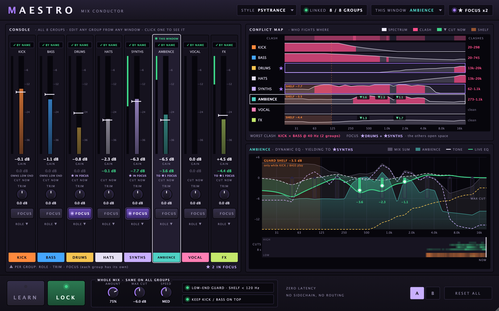](instrumentos/maestro/README.md) | [MAESTRO](instrumentos/maestro/README.md) | Um MAESTRO em cada um dos 8 grupos da mix (KICK, BASS, DRUMS, HATS, SYNTHS, AMBIENCE, VOCAL, FX); as cópias conversam sem sidechain. LEARN ouve o drop, LOCK acerta nível e tom pelo STYLE, LOW-END GUARD abre espaço para kick e baixo e FOCUS destaca quem você escolher com EQ dinâmica. Latência zero |
| [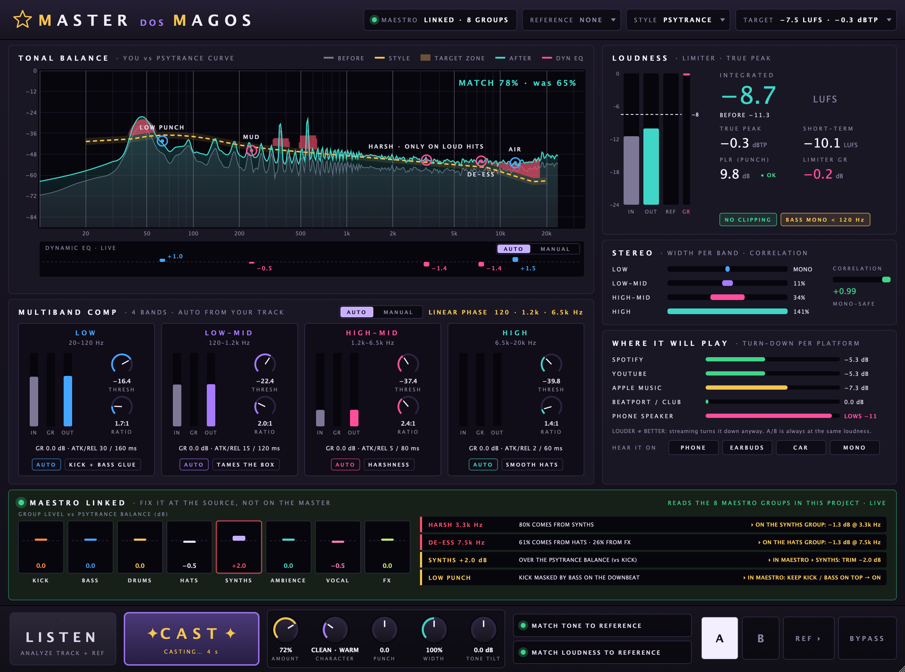](instrumentos/magos/README.md) | [MASTER DOS MAGOS](instrumentos/magos/README.md) | Master num clique com o ouvido na referência: TONE MATCH, multibanda de 4 bandas, EQ dinâmica e limiter true peak até o loudness alvo (teto −0,3 dBTP), em fase linear; A/B com volume igualado, simulador de plataformas e modo MANUAL. Com o MAESTRO no projeto, aponta de qual grupo vem cada problema |
| [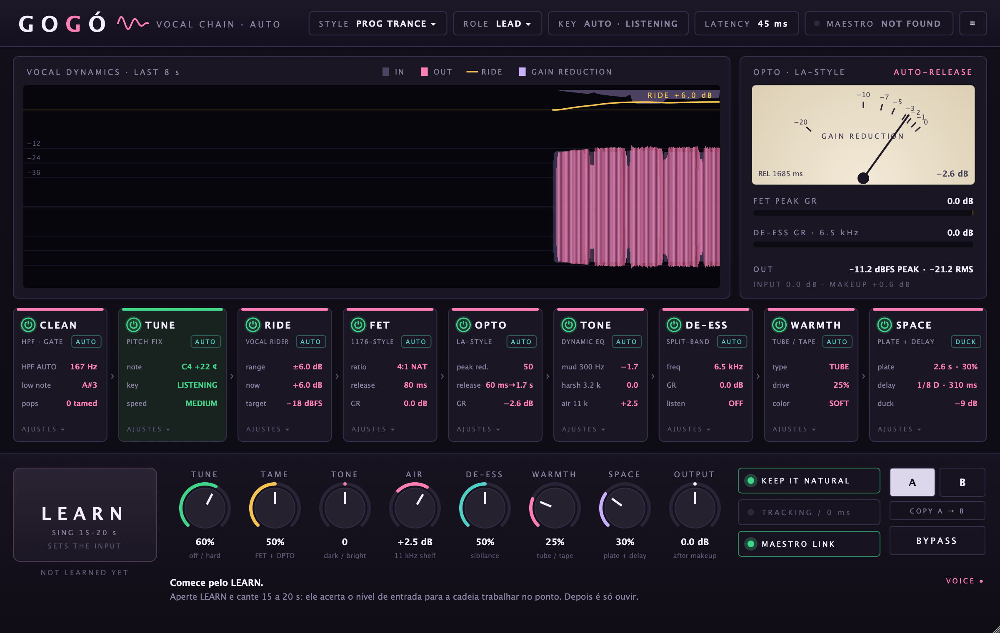](instrumentos/gogo/README.md) | [GOGÓ](instrumentos/gogo/README.md) | A cadeia de voz inteira: CLEAN → TUNE → RIDE → FET → OPTO → TONE → DE-ESS → WARMTH → SPACE, cada bloco com power. LEARN acerta o nível pela sua voz, macros fazem o resto; TRACKING zera a latência para gravar e o MAESTRO LINK abre espaço para a voz |
| [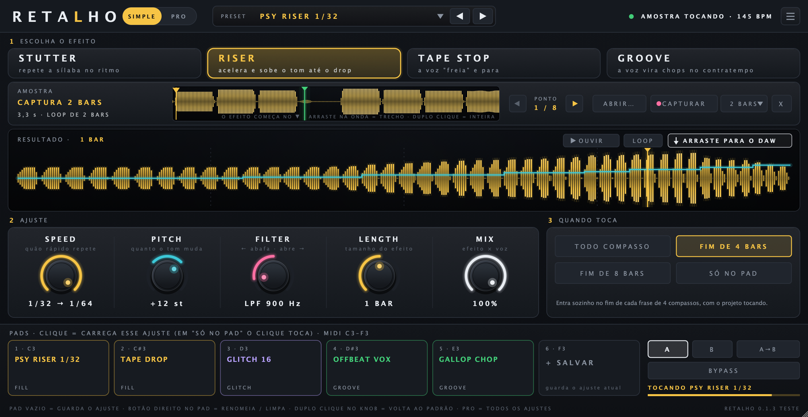](instrumentos/retalho/README.md) | [RETALHO](instrumentos/retalho/README.md) | Sampler de vocal: a voz entra por arquivo, ABRIR ou CAPTURAR e vira stutter (PICOTE), esticada (ESTICA) ou groove de one-shots (GROOVE), no tempo do projeto; pads por MIDI e arrastar para o DAW. **Pago** |
| [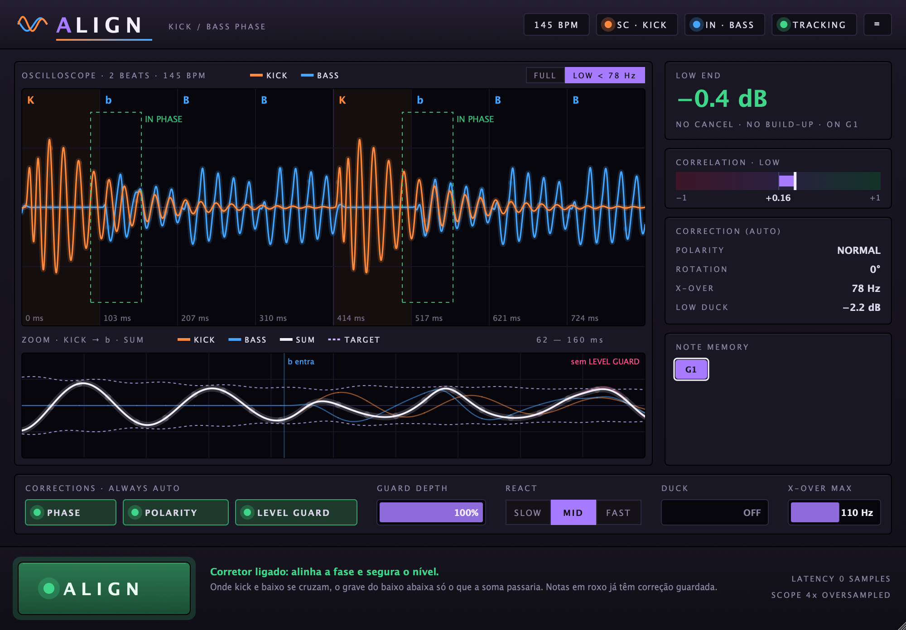](instrumentos/align/README.md) | [ALIGN](instrumentos/align/README.md) | Fase kick/baixo com um botão só: no canal do baixo, o corretor escolhe polaridade e rotação de fase do grave a cada batida e guarda por nota; LEVEL GUARD para alinhar sem virar soma; latência zero. **Grátis.** Desde a 0.3 acha o CHUTE pelo LINK, sem sidechain, e tem DUCK |
| [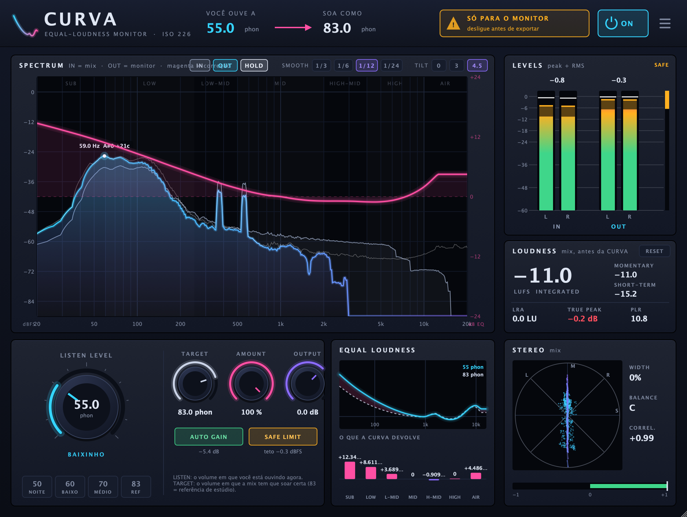](instrumentos/curva/README.md) | [CURVA](instrumentos/curva/README.md) | Monitor de volume pela curva de mesma audibilidade (ISO 226): por último no master, devolve o grave e o agudo que o ouvido perde quando você ouve baixinho; SPECTRUM detalhado, LEVELS, LOUDNESS (R128), TRUE PEAK e STEREO. Só para ouvir. **Teste, grátis** |
|  | [MESA](instrumentos/mesa/README.md) | Console analógica em dois plugins: a MESA CANAL em cada faixa e a MESA no master, cuja janela é o mixer inteiro (canais, grupos e MASTER), com pré, EQ de 4 bandas e compressores. Fora do site desde 14/11 |

## Synths e instrumentos

| Prévia | Instrumento | O que é |
|---|---|---|
| [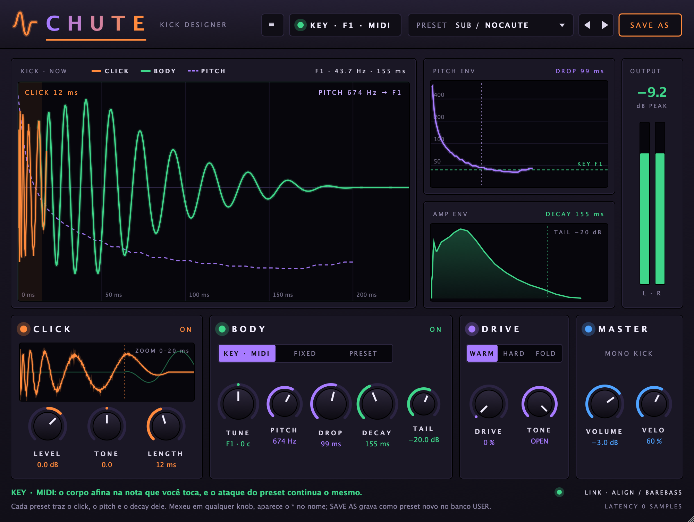](instrumentos/chute/README.md) | [CHUTE](instrumentos/chute/README.md) | Kick designer: bancos SUB, PUNCH, TIGHT e BOOM + USER, corpo afinado por MIDI e knobs para moldar o golpe; publica cada batida pelo LINK para o ALIGN, o BAREBASS, o RESENHA e o GROOVADOR. **Pago** |
| [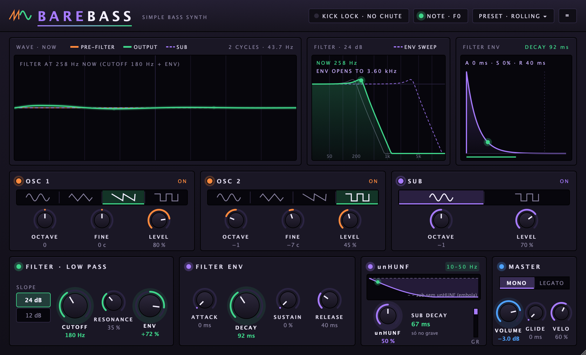](instrumentos/barebass/README.md) | [BAREBASS](instrumentos/barebass/README.md) | Synth de baixo enxuto: 2 osciladores + SUB, filtro 12/24 dB com envelope e unHUNF (o sub bate no começo e some). **Grátis.** Desde a 0.4 trava no kick do CHUTE (KICK LOCK) e tem DUCK |
|  | [QUIMERA](instrumentos/quimera/README.md) | 3 osciladores wavetable, filtro ladder, mod matrix de 16 slots, MPE, 8 efeitos, arpejador com SCALE/ROOT e 400 presets |
|  | [LIMÃO](instrumentos/limao/README.md) | Bassline ácido com alma de 303: filtro ladder de 18 dB/oit, ACCENT que acumula, SLIDE, macro ÁCIDO, drive, delay e reverb, sequenciador de 32 passos com ALEATORIZAR |
|  | [MERCÚRIO](instrumentos/mercurio/README.md) | FM de 4 operadores, 16 vozes, 8 algoritmos desenhados na tela, razões inarmônicas, RING MOD e FOLD, dois filtros e 360 presets |
| [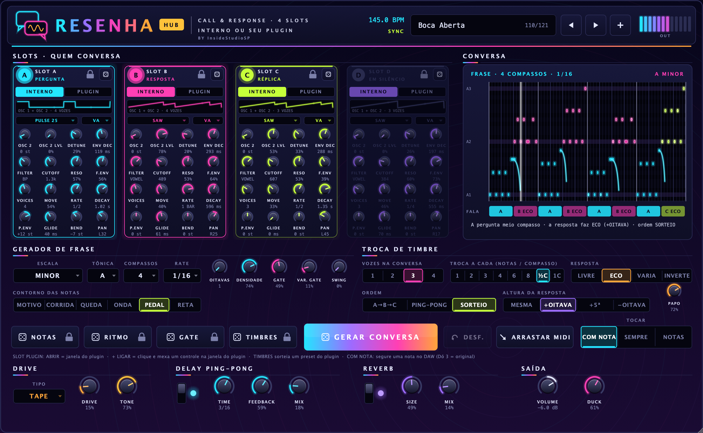](instrumentos/resenha/README.md) | [RESENHA](instrumentos/resenha/README.md) | Call & response: 4 slots que conversam na escala, cada um com o timbre INTERNO ou um synth seu (HUB: VST3, e AU no Mac); gerador de frase, modo NOTAS (toca o MIDI do clipe), contorno RETA e ARRASTAR MIDI. Desde a 0.8 o LINK pega a tônica do CHUTE e segue ou responde o BAREBASS |
| [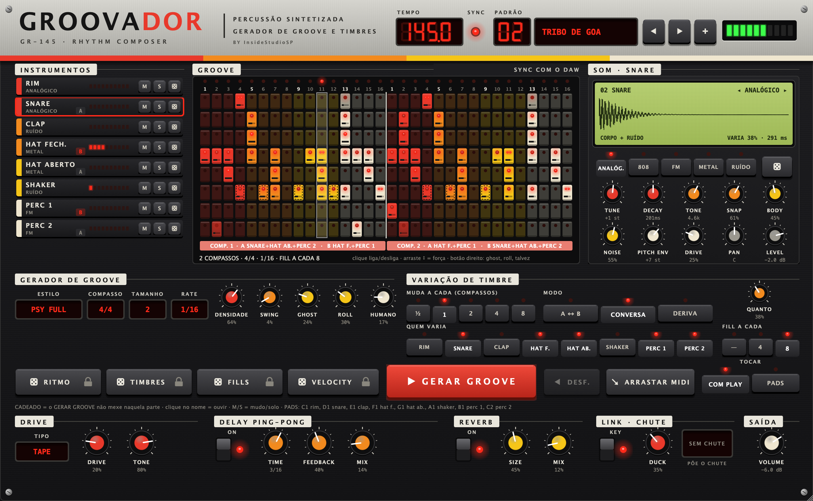](instrumentos/groovador/README.md) | [GROOVADOR](instrumentos/groovador/README.md) | Percussão sintetizada sem bumbo: 8 instrumentos com 5 modelos, grade de até 4 compassos, gerador de groove por estilo e ARRASTAR MIDI. Desde a 0.3 o LINK afina as peças no kick do CHUTE e faz o DUCK dos hats/percs |
| [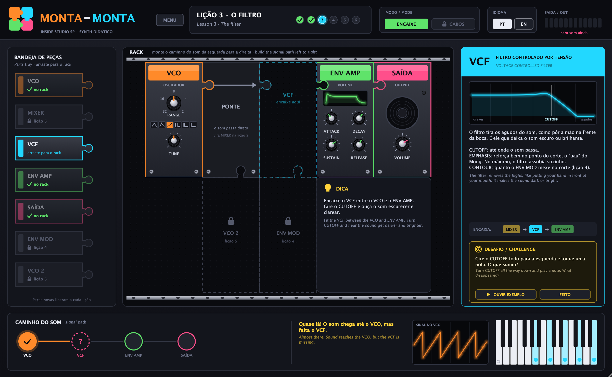](instrumentos/montamonta/README.md) | [MONTA-MONTA](instrumentos/montamonta/README.md) | Synth didático: as peças de um Minimoog se encaixam como quebra-cabeça, com lições e modo CABOS |

## Guitarra

| Prévia | Plugin | O que é |
|---|---|---|
|  | [STOMPBOX](instrumentos/stompbox/README.md) | Pedalboard: até 10 pedais em série (compressor, overdrives, distorção, fuzz, wah, phaser, chorus, delay BBD/fita, reverb, pitch), 5 amps e caixa microfonada, NOISE GATE e afinador; 24 presets |

## SÉRIE CRIATIVO

| Prévia | Plugin | O que é |
|---|---|---|
|  | [GRÃO](plugins/criativo/grao/README.md) | Efeito granular de textura (fita de 4 s, grãos, feedback, cauda, XY) |
|  | [CALEIDO](plugins/criativo/caleido/README.md) | Glitch rítmico (mandala de 16 passos, sync com o BPM) |
|  | [ESPIRAL](plugins/criativo/espiral/README.md) | Phaser/flanger infinito "barber pole" (sobe sem fim, sync com o BPM) |
|  | [FITA](plugins/criativo/fita/README.md) | Gravador de fita: saturation, wow/flutter, hiss, rolos girando e TAPE STOP no BPM |
|  | [CHAMA](plugins/criativo/chama/README.md) | Build-up de um knob só: passa-alta, estéreo, ruído, reverb e gate no tempo, com fogo na tela |
|  | [F1](plugins/criativo/f1/README.md) | Filtro ladder de 4 degraus (low-pass 12/24 dB) com envelope, LFO no grid e FUMAÇA |
|  | [RINGER](plugins/criativo/ringer/README.md) | Ring modulator: carrier de tremolo a sino metálico, LFO no grid e osciloscópio |
|  | [REPETECO](plugins/criativo/repeteco/README.md) | Delay analógico tipo BBD: escurece a cada volta, auto-oscila, INFINITO e MATAR |
|  | [MIRAGEM](plugins/criativo/miragem/README.md) | Reverb atmosférico com shimmer (oitava/quinta), CONGELAR, REVERSO e duck |
|  | [PICOTE](plugins/criativo/picote/README.md) | Gate rítmico de 16 passos com volume, pan e filter por passo, EMBARALHAR e PRENDER |

## SÉRIE MIX

| Prévia | Plugin | O que é |
|---|---|---|
|  | [PRISMA](plugins/mix/prisma/README.md) | Multibanda: 4 bandas com compressor e saturação cada, crossovers arrastáveis no espectro |
|  | [TORNO](plugins/mix/torno/README.md) | Compressor que mostra o que está apertando: histórico de input e gain reduction, curva com knee |
|  | [BARRAGEM](plugins/mix/barragem/README.md) | Limiter de master com true peak e LUFS, com alvos de entrega (Spotify, Apple Music…) |
|  | [CONSOLE](plugins/mix/console/README.md) | Cor de canal de mesa analógica, com 3 modelos: Cristal, Ferro e Brasa |
|  | [SOCO](plugins/mix/soco/README.md) | Modelador de transiente: attack e sustain de cada golpe, com o antes e o depois na tela |
|  | [LIXA](plugins/mix/lixa/README.md) | De-esser de faixa ajustável que mostra no espectro o que está tirando |
|  | [HORIZONTE](plugins/mix/horizonte/README.md) | Imagem estéreo em M/S, sem latência: width de graves e agudos, mono bass, vetorscópio |
|  | [SALA](plugins/mix/sala/README.md) | Reverb limpo e transparente para colocar tudo num mesmo espaço |
|  | [MONITOR](plugins/mix/monitor/README.md) | Medidor de entrega: LUFS, LRA, true peak, espectro e correlação, sem mexer no som |
|  | [NAVALHA](plugins/mix/navalha/README.md) | Clipper 4× que mostra na forma de onda, ao vivo, o que está sendo cortado |

## SÉRIE KNOB

Dez pedais de um knob grandão, todos no tempo do DAW, com TRIGGER por MIDI ou por ataque no sidechain
([detalhes](plugins/knob/README.md)). A base é comum (`plugins/knob/_comum`); cada pedal só traz o motor de som.

| Prévia | Pedal | O que faz o knob |
|---|---|---|
|  | FOLE | Sidechain sincronizado: profundidade do "bombeado" (6 formas) |
|  | PICADOR | Trance gate de 16 passos: corte e, no fim do curso, gate mais curto |
|  | MARÉ | Filtro passa-baixa que abre e fecha no tempo: quanto desce e a ressonância |
|  | VAIVÉM | Auto-pan no tempo: a abertura do passeio |
|  | REPIQUE | Stutter / beat repeat: quanto do compasso vira repetição (ROLL, REPETE, DECAI, TRAVA) |
|  | ECO | Delay de fita no tempo: a realimentação (SIMPLES, PING-PONG, FITA, DUB, ESPALHADO) |
|  | AVESSO | Reverso no tempo: quantas fatias do compasso tocam ao contrário |
|  | FREIO | Tape stop / tape start: quanto do ciclo a freada ocupa |
|  | ESCADA | Sequenciador de pitch: o tamanho dos saltos, sempre dentro da escala |
|  | MASTIGA | Bitcrush ritmado: o quanto morde no pico da forma |

Os efeitos têm presets de fábrica e todos têm janela redimensionável: arraste o canto inferior direito ou use
*Tamanho da janela* no menu de presets (75% a 200%). O tamanho fica salvo no projeto.
No menu de presets: *Salvar como novo*; com um preset do usuário aberto, também *Salvar alterações*, *Renomear* e
*Apagar* (vai para a lixeira). O **+** pede o nome antes de salvar.

## Max for Live

Devices para o Ableton Live 12.2+ (Suite, ou Standard com Max for Live) que mexem no set (clips, faixas), o que um
VST não consegue. Ficam em `max4live/<nome>`, não entram em nenhum build nem instalador: cada um tem um
`build-<nome>.js` que gera o `.amxd`. O workflow `release-max4live.yml` publica o zip pronto no release
`<nome>-vX.Y.Z` quando sobe uma versão nova em `novidades/<Nome>.md` (fica só a última). Ativação na 1ª vez:
**OPEN THE MAGIC** → e-mail + token da compra → **ACTIVATE** (base comum em `max4live/_comum`).

| Prévia | Device | O que é |
|---|---|---|
|  | [VASSOURA](max4live/vassoura/README.md) | Acha os trechos vazios dos clips de áudio de todas as faixas e muta (MUTE) ou apaga (CUT) só o silêncio; THRESHOLD, MIN LENGTH, PRE/POST e SNAP |
|  | [RODO](max4live/rodo/README.md) | Nivela todos os clips pelo Clip Gain, por PEAK, RMS ou LUFS, com PEAK GUARD; modos CLIP, TRACK e ALL; RESET volta os ganhos |
|  | [ESPANADOR](max4live/espanador/README.md) | Reconhece as faixas pelo nome nos 8 grupos do MAESTRO, pinta faixas e clips e cria um BUS por grupo, já com o MAESTRO dentro; UNDO volta tudo |

## Formatos gerados

| | Mac (Intel + Apple Silicon) | Windows 64 bits |
|---|---|---|
| VST3 | sim | sim |
| AU (Logic/GarageBand) | sim | — |

## Como compilar

Não precisa de Mac nem de Visual Studio: o push na `main` dispara o GitHub Actions, que compila no Mac e no Windows,
roda o [pluginval](https://github.com/Tracktion/pluginval) e publica os instaladores.

- `build.yml`: as séries (`plugins/`) — instaladores `InsideStudioSP-Criativo`, `-Mix` e `-Knob` (`.exe` / `.dmg`).
- `build-instrumentos.yml`: cada pasta de `instrumentos/`, com instalador próprio `InsideStudioSP-<Pacote>`.
- `release-max4live.yml`: os zips dos devices Max for Live.
- `shots.yml`: as fotos das telas (branch `shots`).

**Só compila o que mudou.** O job `detectar` (`.github/scripts/pacotes-alterados.sh`) escolhe os pacotes pela pasta
do pacote ou pelo `novidades/<Pacote>.md` dele. Arquivo compartilhado sozinho (`licenca/cliente`, `instalador/`,
CMake da raiz, workflow) não dispara ninguém: entra no próximo build de cada pacote. `.md` dentro das pastas
(README) não compila nada. Quem compila o link de outro pacote entra junto quando o link muda (MAGOS e GOGÓ com o
`MaestroLink` do MAESTRO; ALIGN, BAREBASS, RESENHA e GROOVADOR com o `ChuteLink` do CHUTE; RESENHA com o `BassLink` do BAREBASS). À mão: *Run workflow* com a lista de pacotes
ou `todos`. Um push novo cancela o build da mesma linha que estiver rodando, então junte tudo num push só.

**Fotos:** o `shots` só roda quando o push muda algo visual (`Source/` ou `assets/`) e só do plugin alterado
(`.github/scripts/fotos-alteradas.sh`), mantendo as fotos dos outros na branch `shots`.

Saídas de cada build:
- **Releases**: só a **última versão de cada pacote** (ver abaixo), com os instaladores dos dois sistemas
  (montados por `instalador/montar.py`; nomes e descrições da lista em `instalador/catalogo.json`);
- **artefatos do run** (aba Actions, `report-mac` / `report-win`): os instaladores de qualquer build, mesmo sem versão nova;
- **branches `builds` e `builds-instrumentos`**: os logs de compilação e do pluginval e o `status.txt`.

## Versões e notas de versão

Cada pacote tem o seu arquivo em `novidades/` e o seu release fixo `<pacote>-vX.Y.Z`:

| Linha | Pacotes (`novidades/<Pacote>.md`) |
|---|---|
| Séries (`plugins/`) | Criativo, Mix, Knob |
| Pacotes próprios (`instrumentos/`) | Maestro, Magos, Gogo, Retalho, Chute, Align, Barebass, Stompbox, Quimera, Limao, Mercurio, Resenha, Groovador, Mesa, MontaMonta, Onkey |
| Max for Live (`max4live/`) | Vassoura, Rodo, Espanador |

O primeiro título `## X.Y.Z — data` do arquivo é a **versão atual**. Ela vai para:
- os plugins, pelo `VERSION` do CMake (o host mostra; nos instrumentos ela também aparece no fim do menu de presets);
- o instalador, pelo `instalador/versao.py`, que o workflow passa ao `montar.py`;
- o release fixo daquela versão, com os dois instaladores e o texto da seção como nota.

**Para lançar:** no mesmo commit da mudança, escreva a seção nova no topo do arquivo do pacote, com o que mudou em
linguagem de usuário. O build publica o release `…-vX.Y.Z` só quando:
- a tag ainda não existe (versão já lançada não é sobrescrita);
- saíram os instaladores dos dois sistemas;
- o pluginval não reprovou o pacote.

Criado o release novo, o da versão anterior daquele pacote é apagado: em Releases fica só a última de cada um.

**Versão de teste:** pacote listado em `instalador/pre-release.txt` sai como **pré-release**. O servidor de licenças
ignora pré-release (o download do site e o aviso de atualização continuam na oficial) e a versão anterior não é
apagada. Para oficializar: tirar o pacote da lista e subir a versão.

Número: `X.Y.Z`. Z = correção, Y = recurso novo, X = mudança grande (preset ou projeto antigo que deixa de abrir igual).

## Licença

Os pacotes à venda pedem ativação na 1ª vez: e-mail + token da compra, válido em até 2 computadores. O código do
lado do plugin está em [`licenca/`](licenca/README.md); o servidor de licenças, a loja e o site ficam no repositório
privado `site`. ALIGN e BAREBASS são grátis, com licença gratuita pela página de cada um no site; CHUTE e
RETALHO são pagos, com licença desde a 0.2.0.

## Instalar

**Windows:** abra o `.exe`. A lista vem com todos os plugins do pacote marcados (desmarque os que não quiser), e a
pasta padrão é a do VST3 (`C:\Program Files\Common Files\VST3`), que pode ser trocada. Para desinstalar:
*Configurações → Aplicativos*.

**Mac:** abra o `.dmg` e o `.pkg` dentro dele. Na lista, desmarque o que não quiser; no passo *Destino* dá
para instalar para todos os usuários (`/Library/Audio/Plug-Ins`, padrão) ou só para você
(`~/Library/Audio/Plug-Ins`). O VST3 vai para `VST3/` e o AU para `Components/`. O `LEIA-ME.txt` do `.dmg`
explica como desinstalar.

Os instaladores ainda não são assinados. No Windows, o SmartScreen pede *Mais informações → Executar assim
mesmo*; no Mac, libere em *Ajustes do Sistema → Privacidade e Segurança → Abrir Mesmo Assim*.

No Ableton: *Settings → Plug-Ins*, ligue *Use VST3 Plug-In System Folders* e clique em *Rescan*.

**Max for Live:** copie a pasta do zip inteira para `User Library/Presets/Audio Effects/Max Audio Effect/` e
arraste o `.amxd` para a primeira faixa de áudio do projeto (no master ele não analisa).

## Divulgação e prévias

As fotos das interfaces saem do workflow `shots` e ficam na branch `shots`; as prévias deste README que não estão
lá vêm das imagens do site. Os scripts de vídeo, carrossel e mockup estão em [`divulgacao/`](divulgacao/README.md),
e a prévia 3D dos pedais da SÉRIE KNOB (Blender) em [`plugins/knob/_comum/tools/`](plugins/knob/_comum/tools/README.md).
Nenhum dos dois dispara build.

## Plugin novo

**Numa série:**
1. Copie um plugin da mesma linha para `plugins/<linha>/<nome>` (ex.: `plugins/criativo/repeteco` → `plugins/criativo/<nome>`).
2. No `CMakeLists.txt` dele, troque o nome do alvo, `PRODUCT_NAME`, `BUNDLE_ID` e `PLUGIN_CODE`
   (4 caracteres, com pelo menos uma maiúscula, e **diferente de todos os outros plugins**).
3. Em `instalador/catalogo.json`, acrescente o nome e a descrição que aparecem na lista do instalador.
4. Faça o push. O CMake da raiz encontra a pasta sozinho, e o build põe o plugin no instalador da linha pela pasta.

**Pacote próprio** (`instrumentos/<nome>`): além do acima, registrar o pacote no `paths` do
`build-instrumentos.yml`, no mapa de `.github/scripts/pacotes-alterados.sh`, em `instalador/versao.py`, no
`shots.yml` (foto) e criar o
`novidades/<Pacote>.md` e o `README.md` da pasta.
