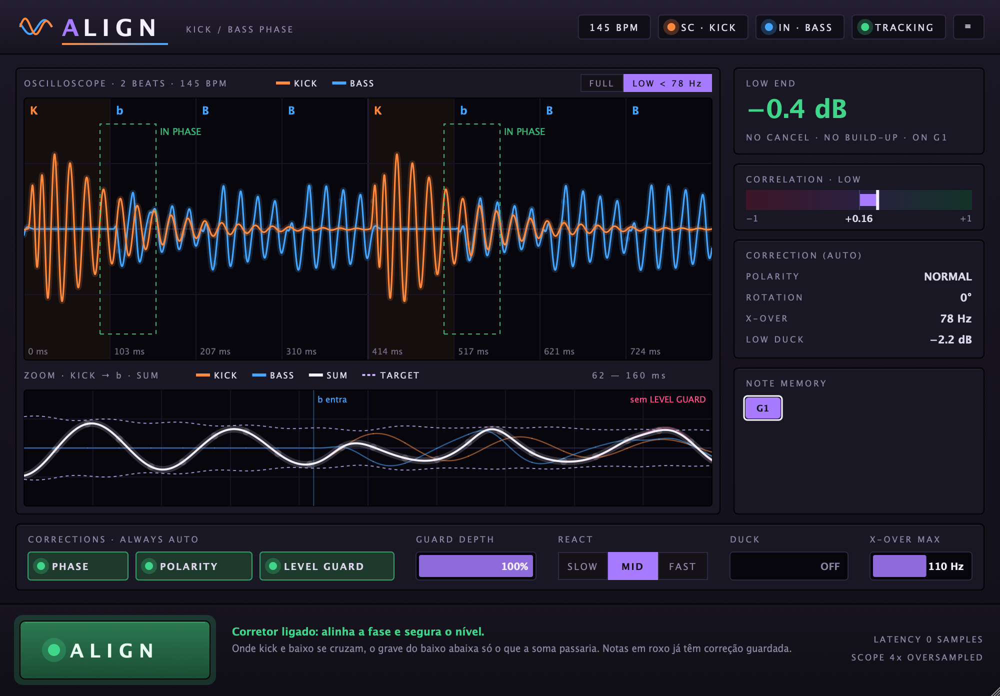
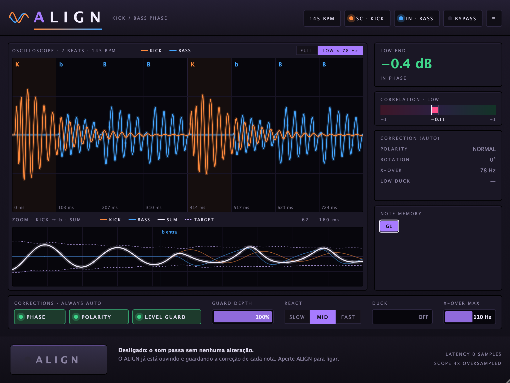

# ALIGN

> **Versão atual: 0.3.2** (24/11/2026) · grátis no site [insidestudiosp.com.br](https://insidestudiosp.com.br) (página `/align`, com licença) · notas em [`novidades/Align.md`](../../novidades/Align.md)

Fase kick/baixo com **um botão só**. Feito para o rolling de psytrance (K b B B), onde a cauda do kick cai em cima
da primeira nota do baixo e os dois cancelam (ou embolam) no grave.

## Como ligar

1. Ponha o ALIGN no canal do **BAIXO**.
2. Mande o **KICK** pelo sidechain (Ableton: abra a seção *Sidechain* do ALIGN e escolha a faixa do kick, *Post FX*).
   **Em teste (0.3.0): LINK.** Com o CHUTE no kick, não precisa de sidechain: o ALIGN acha o CHUTE do mesmo projeto
   sozinho e recria o corpo de cada batida na posição certa. Prioridade: sidechain ligado e com som > LINK > aviso
   "ligue o sidechain ou use o CHUTE". No alto aparece `LINK · <faixa do CHUTE>`; com vários CHUTEs, clique para
   escolher qual seguir.
3. Dê play. O osciloscópio trava em cada batida do kick e o LOW END mostra quanto grave está sumindo (ou somando).
4. Aperte **ALIGN**. Desligado, o som passa sem nenhuma alteração (serve de A/B) e ele continua ouvindo e aprendendo.

## O que ele faz (ligado)

- **Corretor automático contínuo.** A cada batida mede como a cauda do kick e a nota do baixo se somam no grave e
  escolhe, entre 34 combinações de polaridade e rotação de fase (um banco de allpass de 18 a 170 Hz que roda o tempo
  todo), a que soma sem cancelar. Guarda a correção por **nota** do baixo (NOTE MEMORY) e só troca se melhorar mais de
  1 dB; a troca é um crossfade de 10 ms enquanto o kick soa.
- **LEVEL GUARD.** Alinhar não pode virar soma: onde kick e baixo se cruzam, o grave do baixo abaixa só o que passaria
  da soma de potência (nem buraco, nem embolar), até −6 dB. A conta é pela energia da nota, não amostra a amostra.
- **Só no grave do baixo.** Crossover Linkwitz-Riley de 4ª ordem no X-OVER, que acompanha a nota (~1,6 × a
  fundamental, de 60 Hz até o X-OVER MAX). O resto do baixo passa como está.
- **Latência zero.** Nada olha para a frente. A primeira batida de uma nota que ele nunca ouviu pode sair com a
  correção da nota anterior; da segunda em diante sai certa.

A rotação de fase não é linear-phase (não existe rotação sem latência que seja): ela gira a fase do grave do baixo,
que sozinho soa igual; o que muda é como ele soma com o kick.

## DOSE

O corretor segue sempre automático; a faixa DOSE, embaixo do osciloscópio, dosa cada parte (duplo clique nas barras
volta ao padrão; projeto antigo abre como a 0.1.0: tudo ligado, 100%, MID, 110 Hz):

- **PHASE** e **POLARITY** ligam/desligam a rotação de fase e a inversão de polaridade (as duas desligadas = o grave
  passa direto).
- **LEVEL GUARD** liga/desliga o controle de nível; **GUARD DEPTH** (0–100%) dosa quanto ele abaixa.
- **REACT** (SLOW / MID / FAST): a rapidez com que aprende cada nota e troca de correção.
- **X-OVER MAX** (60–150 Hz): o teto do grave corrigido; o X-OVER continua acompanhando a nota.
- **DUCK** (em teste, 0.3.0): sidechain clássico com dosagem. O baixo inteiro abaixa junto com o envelope do kick,
  até a porcentagem da barra, e a barra mostra quanto abaixou. Em 0 fica OFF.

Limites do LINK (0.3.0): efeitos depois do CHUTE (EQ, saturador) não entram na conta (para isso, sidechain); faixa
congelada / passada para áudio ou DAW que isola cada plugin (Bitwig com sandbox) = sem LINK.

## Tela

- **OSCILLOSCOPE · 2 BEATS**: kick (laranja) e baixo (azul) travados no kick, em FULL ou só o grave (LOW < X-OVER).
  Desenho a 4x (interpolado), sem mexer no áudio.
- **ZOOM · KICK → b · SUM**: a passagem da cauda do kick para o b, com a soma (branco), o alvo = soma de potência
  (tracejado roxo) e, ligado, a soma que sairia sem o LEVEL GUARD (rosa).
- **LOW END**: dB perdidos (cancelamento) ou somados no trecho em que os dois se cruzam. Ligado, deve ficar perto de 0.
- **CORRELATION · LOW**, **CORRECTION (AUTO)** (POLARITY, ROTATION, X-OVER, LOW DUCK; OFF na parte desligada na DOSE)
  e **NOTE MEMORY** (em roxo as notas com correção guardada; contorno branco = a nota de agora).

## Código

- `Source/Dsp.h`: o motor inteiro, em C++ puro (sem JUCE).
- `Source/PluginProcessor.*`: parâmetros, sidechain e o LINK (`ChuteLink.h`, o mesmo do CHUTE e do BAREBASS).
- `tools/teste_dsp.cpp`: mede o motor fora do plugin com um rolling a 145 BPM (kick com queda até G1, baixo SAW com
  filtro e envelope): compara a opção aprendida com a melhor de verdade, o LEVEL GUARD, a troca de nota, o desligado
  idêntico à entrada e o nível sem sidechain.
  `zig c++ -O2 -std=c++17 -target x86_64-windows-gnu teste_dsp.cpp -o teste_dsp.exe && teste_dsp.exe`
