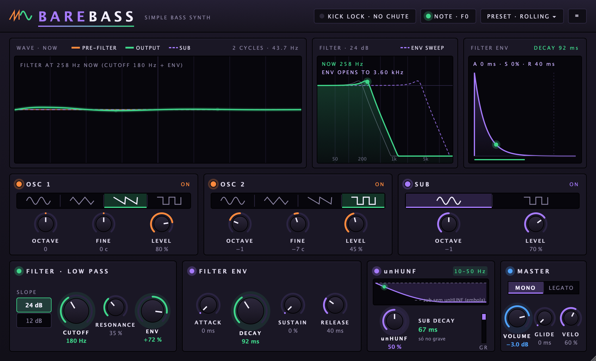

# BAREBASS

> **Versão oficial: 0.4.2** (20/11/2026) · grátis com licença no site [insidestudiosp.com.br](https://insidestudiosp.com.br)
> · notas em
> [`novidades/Barebass.md`](../../novidades/Barebass.md)

Synth de baixo simples (VSTi / AU), uma voz: toca a última nota apertada. Dois osciladores e um SUB, filtro de 12/24 dB
com envelope e o **unHUNF**: o sub bate no começo da nota e some, e o baixo fica seco sem embolar com o kick. Cada nota
começa a onda do mesmo ponto, então todas batem igual. Junto com o ALIGN (ou com o CHUTE, na 0.4.0), kick e baixo
ficam em fase.

## Como usar

1. Ponha o BAREBASS numa faixa MIDI e ative a licença (e-mail + token, 1 computador). Sem ativação o synth fica mudo;
   menu ≡ > Licença… mostra ou desativa.
2. Ele abre no preset **INIT** (FINE e OCTAVE em 0, SUB uma oitava abaixo, filtro aberto). Os outros de fábrica:
   ROLLING, PLUCK, DEEP SUB, ACID 12 e SQUARE GROWL.
3. Toque o rolling e gire o **unHUNF** até o grave sair do caminho do kick.

## O que ele faz

- **OSC 1 e OSC 2**: onda SIN / TRI / SAW / SQR, OCTAVE (−2 a +2), FINE (±50 cents) e LEVEL. **SUB**: SIN / SQR,
  OCTAVE (−2 a 0) e LEVEL. O LED de cada um liga e desliga.
- **Fase**: toda nota redisparada recomeça a onda do ponto inicial (SAW no topo, SQR em +1, SIN e TRI no zero
  subindo). ATTACK em 0 dá o clique seco do ataque.
- **FILTER** passa-baixa de 12 ou 24 dB (SLOPE), com CUTOFF, RESONANCE e ENV (±6 oitavas). **FILTER ENV** com ATTACK,
  DECAY, SUSTAIN e RELEASE.
- **unHUNF**: o sub bate inteiro no ataque e depois perde volume; o corte fica parado no ponto do knob, então o
  grave não desafina (0 cent de erro, medido). O SUB e os OSC em oitava abaixo caem em volume; os OSC na oitava 0 ou
  acima passam por um divisor de bandas fixo e só a parte de baixo cai. Num 1/16 a 143 BPM, o grave abaixo de 50 Hz
  cai ~6 dB com o knob em 50% e ~30 dB em 100%.
- **MASTER**: VOLUME, VELO (quanto a força da nota muda o volume e a abertura do filtro; 0% = toda nota igual),
  GLIDE e o seletor MONO / LEGATO (LEGATO não redispara o envelope quando as notas se encostam).
- A nota na tela segue o Ableton: a nota 60 é C3.

## BASS LINK com o RESENHA (0.4.2)

- O BAREBASS avisa cada nota que toca (nota + posição em tempos) para o RESENHA 0.8.0 do mesmo projeto
  (`Source/BassLink.h`, memória compartilhada pelo PID do DAW). No RESENHA, BAIXO = SEGUE / RESPONDE. O som não muda.

## LINK com o CHUTE (desde a 0.4.0)

- Com o CHUTE no kick do mesmo projeto, o BAREBASS acha o kick sozinho, sem sidechain. O chip **KICK LOCK** no alto
  mostra a nota do kick (NO CHUTE quando não acha).
- **KICK LOCK** ligado: cada nota nasce com o SUB em fase com o corpo do kick naquele instante (as outras ondas andam
  junto, o desenho da onda é o mesmo). Clique no chip para ligar ou desligar. Vem ligado em instância nova; projeto
  salvo antes da 0.4.0 abre desligado (soa igual). Sem CHUTE no projeto, nada muda.

## Tela

- **WAVE · NOW**: dois ciclos da nota tocada, antes do filtro (PRE-FILTER), na saída (OUTPUT) e o sub.
- **FILTER**: a curva com o corte deste instante e até onde o ENV abre.
- **FILTER ENV**: o envelope com o ponto onde a nota está.
- Gráfico do **unHUNF** em dB (0 a −24) nos primeiros 500 ms da nota: o sub com e sem o unHUNF.

## Código

- `Source/Dsp.h`: o motor inteiro (osciladores, filtro, envelope, unHUNF e o KICK LOCK), em C++ puro (sem JUCE).
- `Source/PluginProcessor.cpp`: parâmetros, presets de fábrica, licença e a leitura do LINK (`ChuteLink` do CHUTE).
- `Source/PluginEditor.cpp`: a tela.
- `tools/teste_dsp.cpp`: mede o motor fora do plugin com um baixo rolando em 1/16 a 145 BPM (nível, estalos, CPU,
  filtro, ENV, unHUNF, MONO / LEGATO, GLIDE, fase de cada nota, ATTACK 0, nota encostada e os LEDs).
  `zig c++ -O2 -std=c++17 -target x86_64-windows-gnu teste_dsp.cpp -o teste_dsp.exe && teste_dsp.exe`
