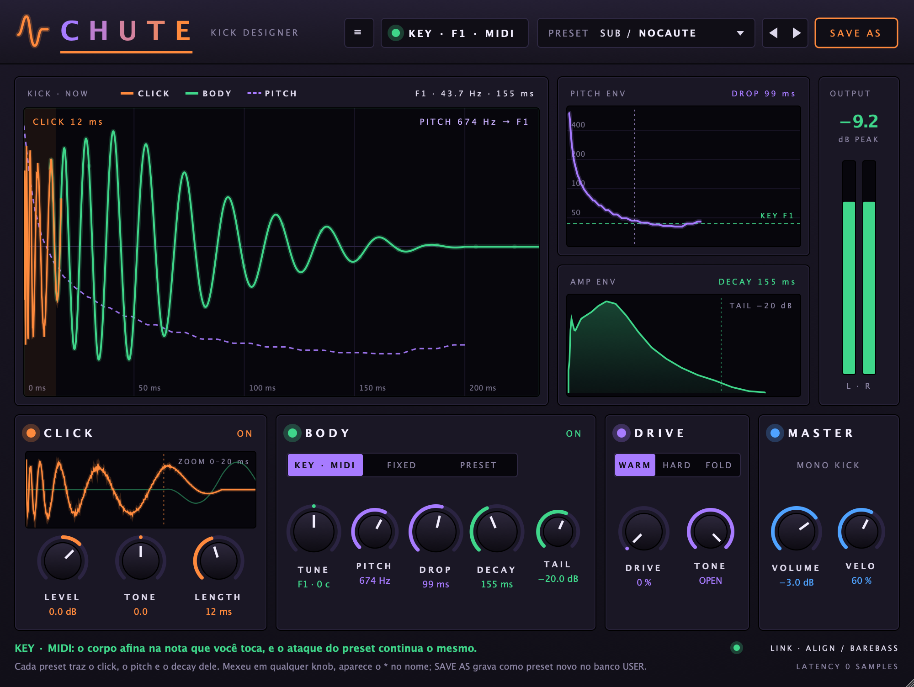

# CHUTE — KICK DESIGNER

> **Versão atual: 0.2.2** (25/11/2026) · oficial, paga, com licença (pacote `chute`; lançamento no site 22/11) · notas em
> [`novidades/Chute.md`](../../novidades/Chute.md)

Kick designer (VSTi / AU): cada nota MIDI toca uma batida, com o **CLICK** (o ataque do preset) e o **BODY** (o corpo
do kick, afinável). O corpo pode seguir a nota que você toca, então o kick fica no tom da música. Com o **LINK**, o
ALIGN e o BAREBASS do mesmo projeto enxergam cada batida sem sidechain. Latência zero.

## Como usar

1. Ponha o CHUTE numa faixa MIDI e escreva as batidas do kick no clipe.
2. Escolha um preset no menu (a nota de cada um aparece em cifra: C1, D#1, F#1…) ou passe por eles com ◀ ▶.
3. Escolha como o corpo afina (KEY · MIDI, FIXED ou PRESET) e ajuste os knobs. Mexeu em qualquer knob, o nome do
   preset ganha `*`; **SAVE AS** grava como preset novo no banco USER. Duplo clique num knob volta ao valor do preset.

## Presets

50 de fábrica em 4 bancos (**SUB**, **PUNCH**, **TIGHT**, **BOOM**), com nomes de golpe de luta, mais o banco
**USER** com os seus. ◀ ▶ passam pelos de fábrica, pelos bancos instalados e pelos USER.

**Bancos novos** (0.1.3): arquivos .chutebank (formato em Source/Bancos.h, ferramenta 	ools/banco.py, regras em
[ancos/README.md](bancos/README.md)). Saem num instalador só de presets (InsideStudioSP-ChuteBancos, sem
atualizar o plugin) e aparecem no menu depois dos de fábrica quando o DAW reabre.

## O que ele faz

- **CLICK** (liga/desliga): LEVEL, TONE e LENGTH (2 a 25 ms, com crossfade para o corpo).
- **BODY** (liga/desliga): a nota em três modos:
  - **KEY · MIDI**: o corpo afina na nota que você toca, e o ataque do preset continua o mesmo;
  - **FIXED**: o corpo fica na nota do preset, afinada; o TUNE troca a nota;
  - **PRESET**: o corpo fica na afinação original do preset; o TUNE soma semitons.

  Knobs: TUNE (±12 semitons), PITCH (onde a queda começa), DROP (velocidade da queda), DECAY (comprimento) e TAIL
  (quanto sobra no fim).
- **DRIVE**: WARM, HARD ou FOLD, com DRIVE e TONE (fecha o agudo só da saturação; com DRIVE em 0 não muda nada).
- **MASTER**: VOLUME e VELO. Kick é mono: a batida nova sempre corta a anterior (o CHOKE / POLY saiu na 0.1.2).
- **LINK**: cada batida vai para o ALIGN (0.3.0) e o BAREBASS (0.4.0) do mesmo projeto, sem sidechain. No BAREBASS,
  o KICK LOCK faz cada nota do baixo nascer com o sub em fase com o corpo do kick. O rodapé mostra
  LINK · ALIGN / BAREBASS ou LINK OFF.

## Tela

- **KICK · NOW**: a batida do preset desenhada (ataque em laranja, corpo em verde, curva de pitch tracejada), com o
  zoom do CLICK nos primeiros 20 ms.
- **PITCH ENV** (com o DROP em ms) e **AMP ENV** (com o DECAY em ms e o TAIL).
- **OUTPUT**: o medidor de saída.

## Código

- `Source/Dsp.h`: o motor (CLICK, BODY, DRIVE + TONE só na saturação), em C++ puro (sem JUCE).
- `Source/Bancos.h`: o formato `.chutebank` e o catálogo (fábrica de dentro do plugin + bancos instalados), sem JUCE.
  Sem chave: a fábrica é `bancos/fabrica/FABRICA.chutebank` (BinaryData, `bancos.cmake`).
- `tools/teste_dsp.cpp`: bancada do motor e do leitor de bancos
  `zig c++ -std=c++17 -O2 -I ../Source teste_dsp.cpp ../Source/ChuteLink.cpp -o teste_dsp.exe` →
  `teste_dsp.exe ../bancos/fabrica/FABRICA.chutebank`
- `Source/PluginProcessor.cpp`: parâmetros, presets (fábrica e USER) e a publicação das batidas no LINK.
- `Source/PluginEditor.cpp`: a tela.
- `Source/ChuteLink.h` e `Source/ChuteLink.cpp`: o LINK. O CHUTE escreve cada batida numa memória compartilhada do
  processo do DAW e o ALIGN e o BAREBASS leem (DAW que isola cada plugin num processo = sem link, pede o sidechain).
- `tools/teste_link.cpp`: bancada do LINK (sem JUCE): o corpo recriado do lado de quem lê bate com o do CHUTE, a
  batida que chega um bloco atrasada cai na posição certa, o loop do DAW não toca batida velha e a vaga some quando o
  CHUTE é destruído.
  `zig c++ -std=c++17 -O2 -I ../Source teste_link.cpp ../Source/ChuteLink.cpp -o teste_link.exe` →
  `teste_link.exe ../bancos/fabrica/FABRICA.chutebank`
