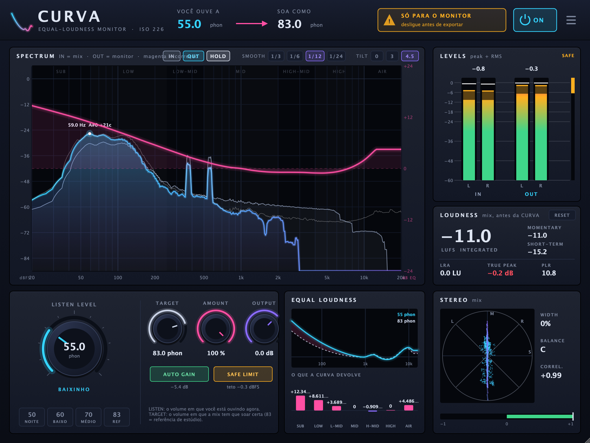

# CURVA

Monitor de volume pela curva de mesma audibilidade (Fletcher-Munson / ISO 226:2003). Grátis, na linha do ALIGN e do
BAREBASS. **0.2.0 oficial, grátis com licença** (pacote `curva`, token grátis em insidestudiosp.com.br/curva/; sem ativar o som passa direto).

## Para que serve

Baixinho, o ouvido perde grave e agudo. A mix feita de madrugada sai com grave demais quando toca alto. A CURVA vai
por ÚLTIMO no master e devolve ao monitor o que o ouvido perde no volume em que você está (LISTEN LEVEL) em relação ao
volume de referência (TARGET, 83 phon). É só para ouvir: desligue ou tire antes de exportar.

## Controles

| Controle | O que faz |
|---|---|
| LISTEN LEVEL | Volume em que você está ouvindo (40–90 phon). Atalhos NOITE 50, BAIXO 60, MÉDIO 70, REF 83 |
| TARGET | Volume em que a mix tem que soar certa (60–90, padrão 83) |
| AMOUNT | Dose da correção (0–100%) |
| OUTPUT | Ganho de saída (−24 a +12 dB) |
| AUTO GAIN | Mantém o volume geral igual ao da mix (ruído rosa igual antes e depois) |
| SAFE LIMIT | Teto em −0,3 dBFS para proteger os falantes |
| ON / OFF | Liga e desliga sem estalo |

## Tela

SPECTRUM (IN = mix, OUT = monitor, magenta = correção; SMOOTH, TILT, HOLD e leitura no mouse), LEVELS, LOUDNESS da mix
antes da CURVA (I, M, S, LRA, TRUE PEAK, PLR), EQUAL LOUDNESS (as duas curvas ISO 226 e o ganho por faixa) e STEREO
(vectorscope, correlação, largura, balanço).

## Código

- `Source/Curva.h`: o motor sem JUCE (ISO 226, correção, FIR de fase mínima, loudness BS.1770-4, true peak 4x,
  limitador). Teste: `tools/teste_curva.cpp` (`c++ -std=c++17 -O2 -ISource tools/teste_curva.cpp`).
- `Source/PluginProcessor.*`: filtro (juce::dsp::Convolution com latência zero), medidores e anéis para a tela.
- `Source/PluginEditor.cpp` (análise, topo, espectro, mouse), `Source/EditorPaineis.cpp` (painéis e menu),
  `Source/EditorTema.h` (paleta e peças).
