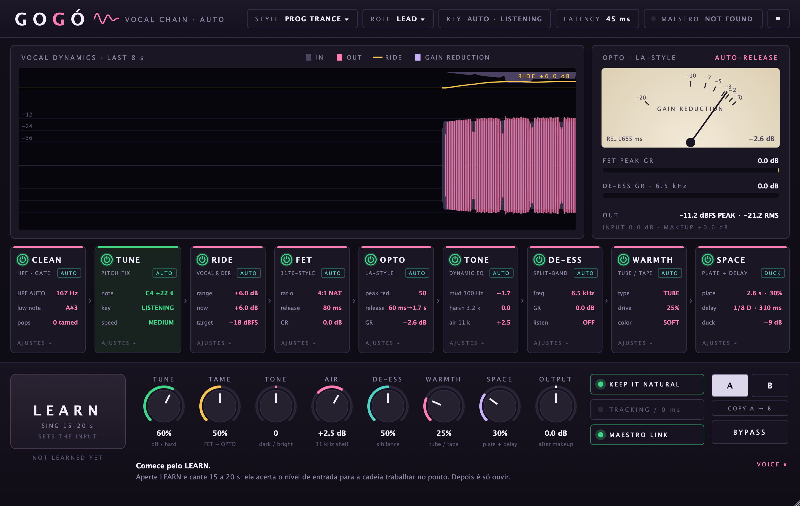
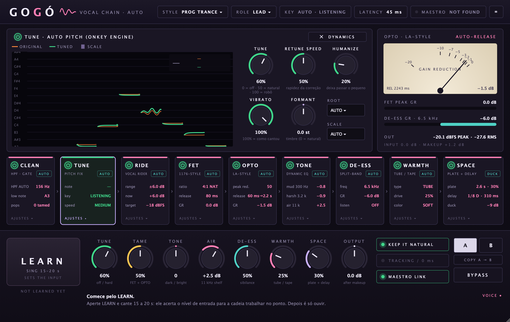

# GOGÓ

> **Versão atual: 0.2.1** (24/11/2026) · à venda com licença no site [insidestudiosp.com.br](https://insidestudiosp.com.br)
> · notas em [`novidades/Gogo.md`](../../novidades/Gogo.md)

Cadeia de voz automática (VST3 / AU) num plugin só. Vai no canal da VOZ (uma voz só) e substitui a cadeia de plugins
da voz: 9 blocos na ordem certa, cada um com liga/desliga. O **LEARN** ouve a sua voz e acerta o nível; você ajusta
pelas macros. O bloco **TUNE** é o motor do ONKEY inteiro.

## Como usar

1. Ponha o GOGÓ no canal da voz e ative a licença (e-mail + token, até 2 computadores; desativar libera a vaga).
   Sem ativar, o som passa direto, com o mesmo atraso do TUNE. Menu ≡ > Licença… mostra a licença ativa.
2. Escolha o **STYLE** (PROG TRANCE, PSY TRANCE, POP, TRAP / HIP-HOP, FUNK, PODCAST), que grava um ponto de partida
   nos ajustes, e o **ROLE** (LEAD, DOUBLE / BACKING, ADLIB / FX, SPOKEN).
3. Aperte **LEARN** e cante 15 a 20 s: ele acerta o INPUT para a voz chegar a −18 dBFS RMS.
4. Ajuste pelas macros (TUNE, TAME, TONE, AIR, DE-ESS, WARMTH, SPACE, OUTPUT). Um clique no bloco abre os AJUSTES dele.

## A cadeia

CLEAN → TUNE → RIDE → FET → OPTO → TONE → DE-ESS → WARMTH → SPACE. Cada bloco tem botão de power (liga e desliga só
ele, sem estalo); o liga/desliga entra no projeto e no A/B.

- **CLEAN**: HPF de 24 dB/oitava (AUTO = 0,7 × a nota mais grave cantada), corte do "p" e do "b" na hora (contados na
  tela) e GATE suave entre as frases.
- **TUNE**: o motor do ONKEY (acha o tom e a escala sozinho, corrige pelo centro da nota, vibrato e slides passam,
  formantes preservados). Macro TUNE: 0 = desligado, 50 = natural, 100 = robô. Nos ajustes: RETUNE SPEED, HUMANIZE,
  VIBRATO, FORMANT, ROOT / SCALE e o gráfico de afinação.
- **RIDE**: vocal rider antes da compressão; leva cada trecho cantado a −18 dBFS RMS, no máximo ±RANGE, e para no
  silêncio.
- **FET** (pega pico, estilo 1176) e **OPTO** (nivelador estilo LA-2A, release em dois estágios), os dois pela macro
  TAME, com ganho de volta automático.
- **TONE**: EQ dinâmica que compara com a média da SUA voz: MUD (300 Hz) e HARSH (3,2 kHz); TONE (escuro / brilhante)
  e AIR (shelf em 11 kHz).
- **DE-ESS** de banda dividida (FREQ, LISTEN): baixa o "s" e deixa a vogal igual.
- **WARMTH**: TUBE ou TAPE, com anti-aliasing.
- **SPACE**: PLATE + DELAY ping-pong no tempo do DAW, os dois com DUCK (abaixam enquanto canta e voltam nas pausas).
  O **GUARD** segura o efeito 5 dB abaixo do nível médio da voz, então nem com tudo no máximo ele ressoa ou distorce.
- **OUTPUT**: limitador em −1 dBFS.

## Mais

- **KEEP IT NATURAL** limita o automático (TUNE nunca robô, FET em 4:1, de-ess, EQ e WARMTH mais leves).
- **TRACKING** tira o TUNE do caminho e a latência vai a 0 para gravar. Com o TUNE, a latência é de ~45 ms
  (compensada pelo DAW).
- **MAESTRO LINK**: lê o MAESTRO no mesmo projeto (grupos ligados no topo) e realça +1,5 dB na banda de 2 a 4 kHz em
  que os SYNTHS deixam mais espaço.
- **A / B** (COPY A → B) e **BYPASS** (o som passa sem alteração, só com a latência).

## Tela

- **VOCAL DYNAMICS** dos últimos 8 s: IN, OUT, RIDE e GAIN REDUCTION.
- VU do OPTO, redução do FET e do DE-ESS, pico e RMS da saída.
- 3 leituras ao vivo em cada bloco; o SPACE mostra GUARD quando ele está agindo.
- O bloco TUNE aberto (acima): o gráfico de afinação e os ajustes.

## Código

- `Source/Dsp.h`: a cadeia inteira (com os STYLE e ROLE), em C++ puro (sem JUCE).
- `Source/TuneDsp.h`: o motor do bloco TUNE, copiado igual do ONKEY.
- `Source/Link.cpp`: o MAESTRO LINK (abre, só lendo, a memória compartilhada do MAESTRO).
- `Source/PluginProcessor.cpp`: parâmetros, licença e latência.
- `Source/PluginEditor.cpp`: a tela.
- `tools/teste_dsp.cpp`: bancada (sem JUCE) com uma voz sintética (verso baixo, refrão alto, "s" e "p") passada pela
  cadeia inteira: CPU, NaN, nível do verso × refrão, GR de cada bloco, "pops", de-ess no "s", bypass = entrada
  atrasada pela latência, tudo desligado = transparente e estalo ao ligar/desligar bloco.
  `zig c++ -O2 -std=c++17 -I ../Source teste_dsp.cpp -o teste_dsp.exe`
