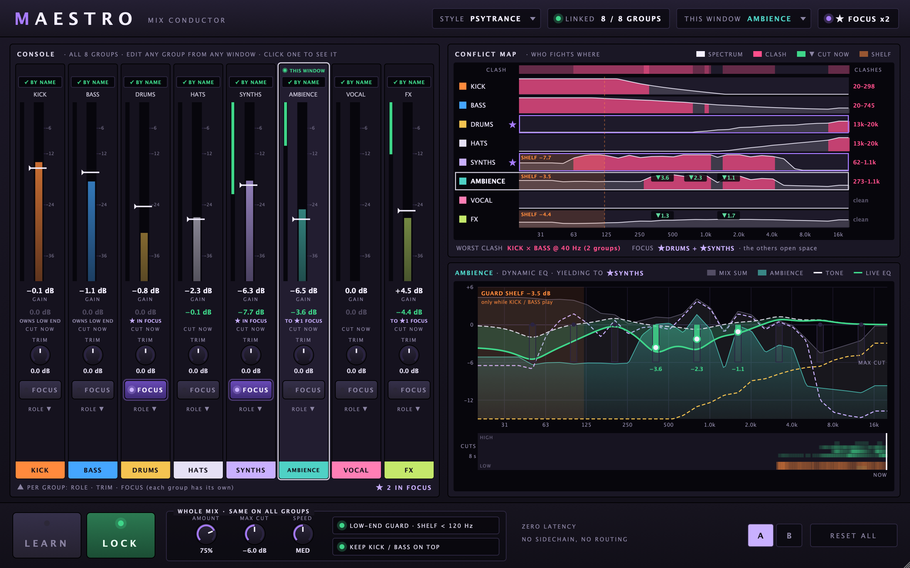
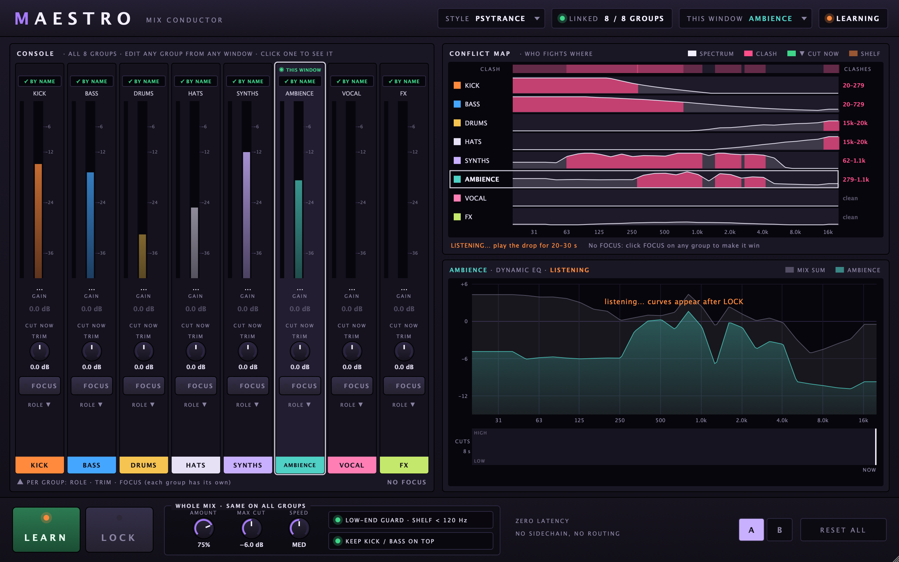
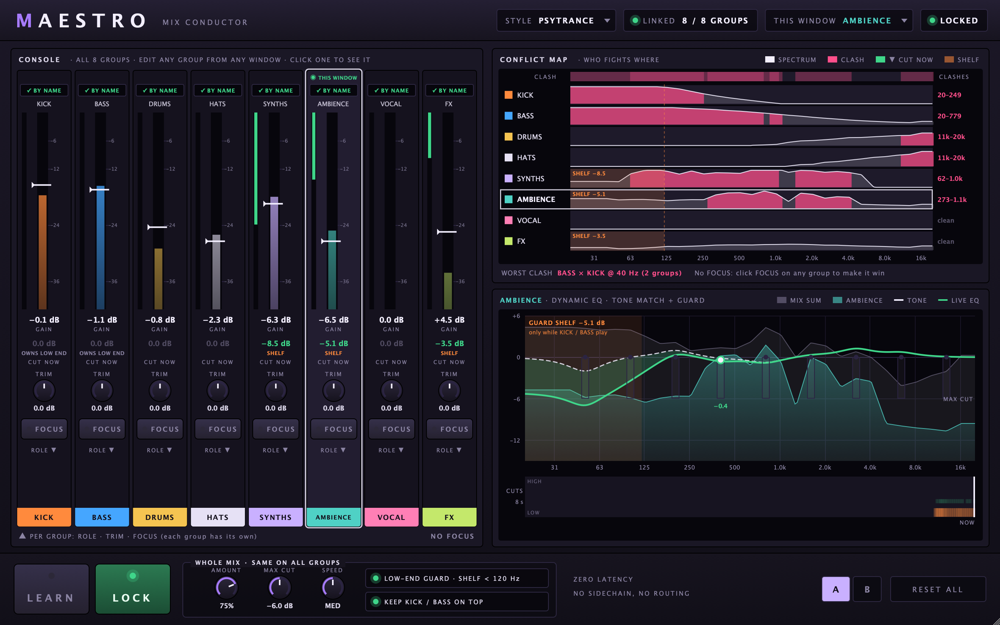
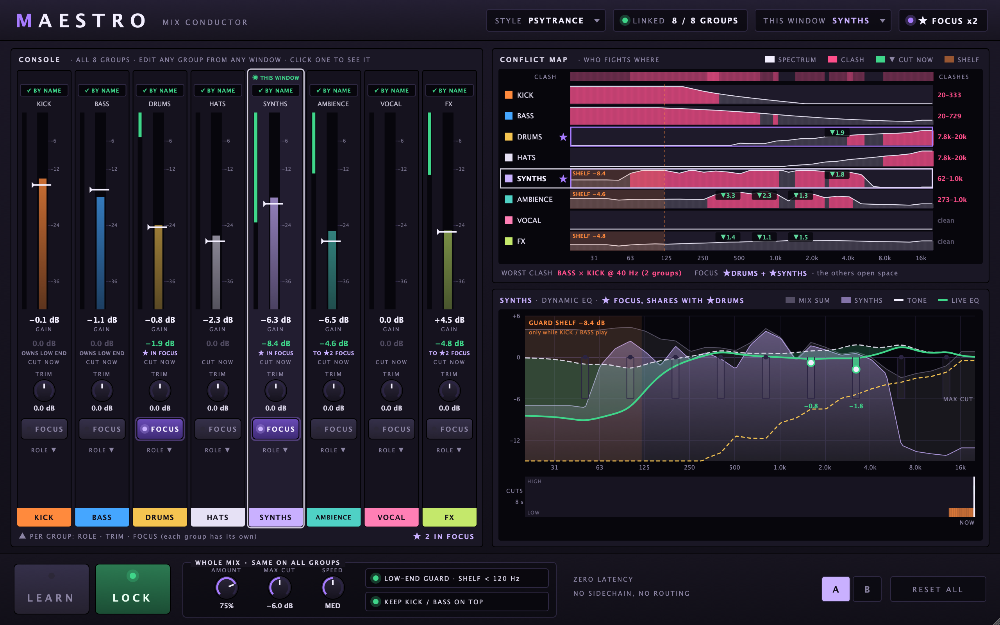

# MAESTRO — MIX CONDUCTOR

> **Versão atual: 0.2.4** (25/11/2026) · à venda com licença no site [insidestudiosp.com.br](https://insidestudiosp.com.br)
> · notas em [`novidades/Maestro.md`](../../novidades/Maestro.md)

Um MAESTRO em cada grupo da mix (VST3 / AU). As cópias conversam entre si, sem sidechain nem roteamento: **LEARN**
ouve o drop, **LOCK** acerta o nível e o tom de cada grupo pelo STYLE, o **LOW-END GUARD** abre espaço para o kick e
o baixo e o **FOCUS** destaca quem você escolher com EQ dinâmica. Um rascunho de mix equilibrado em segundos, para
você terminar do seu jeito. Latência zero. É o par do [MASTER DOS MAGOS](../magos/README.md).

## Como usar

1. Ponha o MAESTRO nos 8 grupos (stems) da mix, depois dos efeitos de cada um: **KICK, BASS, DRUMS** (snare +
   percs), **HATS, SYNTHS, AMBIENCE, VOCAL** e **FX**. Ele reconhece o grupo pelo nome (Kick, Bass, Drums, Snare,
   Percs, Hats, Synths, Lead, Ambience, Pad, Vocal, FX…); sem nome, adivinha pelo som (GUESS). Dá para escolher o
   ROLE na mão. Continua funcionando canal a canal.
2. Ative a licença (e-mail + token, até 2 computadores; desativar libera a vaga). Sem ativar, o som passa direto.
   Menu do logo > License… mostra a licença ativa.
3. Escolha o **STYLE** (PSYTRANCE, PROG PSY, TECHNO, HOUSE, DRUM & BASS, POP).
4. **LEARN**: toque o drop por 20–30 s. Cada grupo mede nível e espectro enquanto toca.
5. **LOCK**: cada grupo vai ao nível do STYLE, relativo ao KICK, com um TONE MATCH suave (9 bandas de 1 oitava).
   Trocar o ROLE depois do LOCK refaz o LOCK do projeto inteiro.
6. Ponha **FOCUS** em quem tem de aparecer (um ou vários).

## O que ele faz

- **LOW-END GUARD**: enquanto o KICK e o BASS tocam, os outros grupos abaixam abaixo de 120 Hz (shelf dinâmico, só
  quanto o grave daquele grupo atrapalha, até −12 dB × AMOUNT). Nenhum passa-altas; KICK e BASS nunca são cortados.
- **FOCUS** (por grupo, automatizável): os outros cedem só nas frequências em que mascaram a FOCUS e só enquanto ela
  toca (EQ dinâmica, até MAX CUT). Vários em FOCUS ao mesmo tempo, sem prioridade: duas FOCUS que batem na mesma
  banda cedem um pouco uma para a outra, por igual (até 3 dB). KICK e BASS são os donos do grave e nunca cedem.
- **KEEP KICK / BASS ON TOP**: os outros cedem para o kick e o baixo abaixo de ~400 Hz.
- **WHOLE MIX** (vale para todos): AMOUNT, MAX CUT, SPEED, LOW-END GUARD, KEEP KICK / BASS ON TOP. **TRIM** é o
  ajuste por grupo. **A / B** compara com a mix original no projeto todo; **RESET ALL** volta tudo.
- Antes do LOCK e sem FOCUS, o som passa sem nenhuma alteração. Latência zero (só IIR).
- **MAESTRO LINK**: o MAESTRO publica os 8 grupos (nível e espectro) para o MASTER DOS MAGOS no master, que mostra de
  qual grupo vem cada problema (MAESTRO LINKED), e para o GOGÓ, que abre espaço para a voz onde os SYNTHS deixam. Não
  muda nada no som do MAESTRO.
- Funciona em DAW com os plugins no mesmo processo (Ableton Live, Logic, FL Studio, Reaper, Studio One, Cubase). Com
  sandbox de plugin (Bitwig), cada cópia só enxerga a própria faixa.

## Tela

- **CONSOLE CENTRAL**: qualquer janela mostra os 8 grupos lado a lado e mexe em qualquer um (ROLE, TRIM, FOCUS). Cada
  tira: de onde veio o grupo (BY NAME / BY SOUND), o nome da faixa, medidor com a marca do alvo do STYLE, GAIN,
  CUT NOW com a causa (IN FOCUS, TO FOCUS, SHELF, OWNS LOW END), TRIM, FOCUS e ROLE.
- **MAPA DE CONFLITO**: uma pista por grupo com o espectro em branco e, onde ele briga com outro grupo, vermelho.
  Faixa CLASH no topo, o trecho de Hz da briga, ▼ com o corte de agora e o shelf do GUARD em laranja.
- **EQ DINÂMICA** do grupo clicado: espectro da soma da mix atrás, espectro do grupo, FOCUS dos outros tracejados,
  TONE MATCH e LIVE EQ separados, os 9 nós com o alcance até MAX CUT, a região do GUARD e os cortes dos últimos 8 s.

## Código

- `Source/Dsp.h`: o motor (grupos, LEARN, LOCK, GUARD, FOCUS e o registro em que as cópias se enxergam), em C++ puro.
- `Source/MaestroLink.h` e `Source/MaestroLink.cpp`: o MAESTRO LINK (memória compartilhada com nome pelo PID do
  processo do DAW), lido pelo MASTER DOS MAGOS e pelo GOGÓ.
- `Source/Janela.cpp`: lê o nome da faixa do título da janela em que o DAW põe o plugin (o Ableton não manda o nome).
- `Source/PluginProcessor.cpp`: parâmetros, licença e o nome da faixa guardado no projeto.
- `Source/PluginEditor.cpp`: a tela.
- `tools/teste_dsp.cpp`: bancada com um projeto de psytrance sintético (145 BPM, 11 faixas): parado = entrada idêntica,
  LEARN + LOCK contra o alvo do PSYTRANCE, FOCUS no LEAD, A/B idêntico, NaN / estalos e CPU com 150 faixas.
  `zig c++ -O2 -std=c++17 -target x86_64-windows-gnu teste_dsp.cpp -o teste_dsp.exe && teste_dsp.exe`
