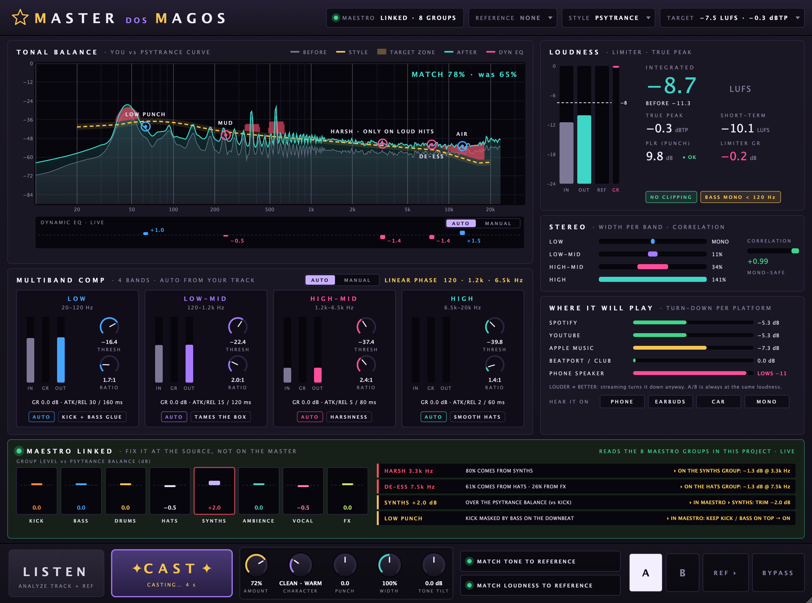
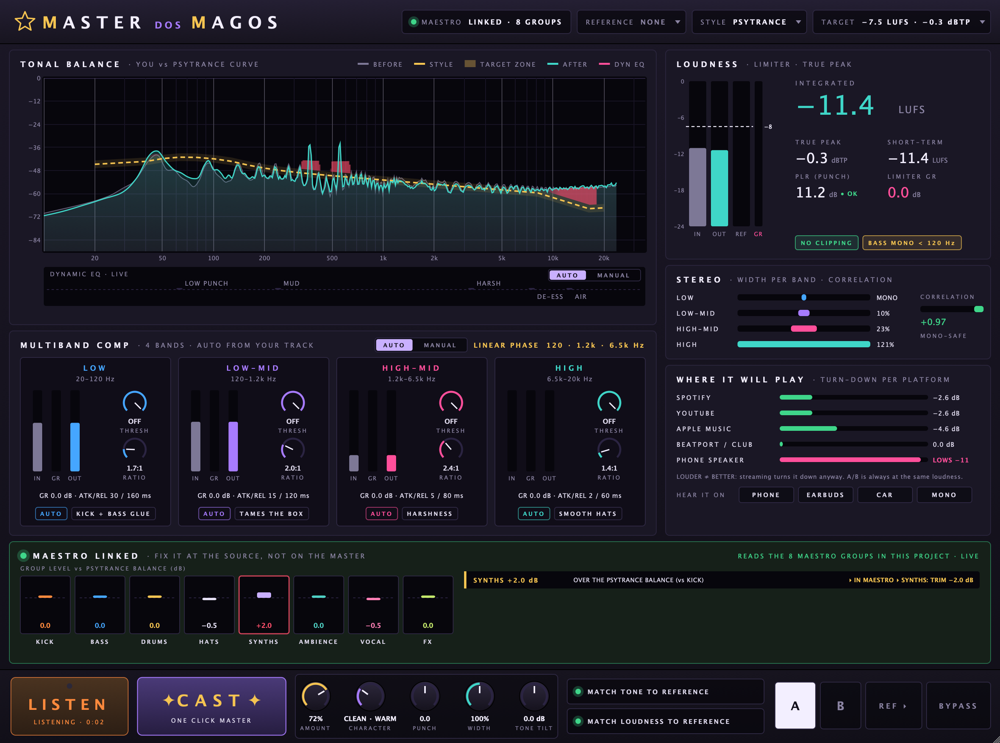
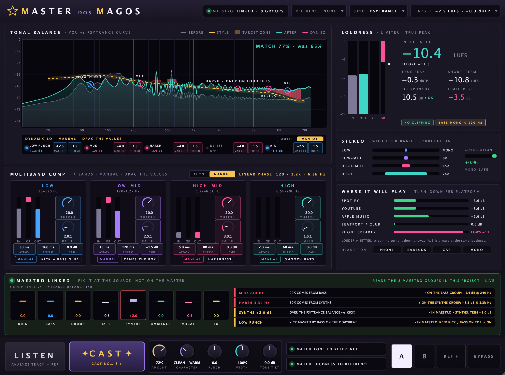

# MASTER DOS MAGOS — MASTERING WIZARD

> **Versão atual: 0.2.2** (25/11/2026) · à venda com licença no site [insidestudiosp.com.br](https://insidestudiosp.com.br)
> (avulso ou no combo com o MAESTRO) · notas em [`novidades/Magos.md`](../../novidades/Magos.md)

Masterizador (VST3 / AU), o par do [MAESTRO](../maestro/README.md). Vai por último no master. Solte uma faixa de
referência (ou use a curva do STYLE), aperte **LISTEN** no drop e depois **CAST**: ele acerta o balanço tonal, ajusta
o compressor de 4 bandas, liga a EQ dinâmica e leva o limitador true peak até o loudness alvo. Tudo em fase linear.
Com o MAESTRO no projeto, mostra de qual grupo da mix vem cada problema.

## Como usar

1. Ponha o MASTER DOS MAGOS por último no master e ative a licença (e-mail + token, até 2 computadores; desativar
   libera a vaga). Sem ativar, o som passa direto, com a mesma latência. Menu do logo > License… mostra a licença.
2. Arraste uma **REFERÊNCIA** (WAV, AIFF, FLAC, OGG, MP3) para a janela. Sem ela, o alvo é a curva do **STYLE**
   (PSYTRANCE, PROG PSY, TECHNO, HOUSE, DRUM & BASS, POP).
3. **LISTEN**: toque o drop por 20–30 s.
4. **CAST** (um clique). Nos primeiros ~20 s o nível se acerta sozinho; se o limitador precisar tirar mais de 5 dB,
   ele para antes do alvo e avisa.
5. Ajuste o resultado com AMOUNT, CHARACTER, PUNCH, WIDTH e TONE TILT, ou passe para o MANUAL.

## O que o CAST faz

- **TONE MATCH**: 9 bandas de 1 oitava, até ±6 dB, na direção da referência (ou do STYLE).
- **DYNAMIC EQ**: corta MUD (240 Hz), HARSH (3,3 kHz) e DE-ESS (7,5 kHz) só nos picos; realça LOW PUNCH (63 Hz) e AIR
  (12,5 kHz) só quando faltam.
- **MULTIBAND COMP** de 4 bandas (120 / 1,2 k / 6,5 kHz) com limiar automático.
- Graves em **MONO** abaixo de 120 Hz.
- **LIMITER** true peak com teto de −0,3 dBTP, levando ao **TARGET** (AUTO = o loudness da referência).
- **FASE LINEAR** em todo o caminho: TONE MATCH, TILT, DYNAMIC EQ e o crossover das 4 bandas não giram a fase (o
  transiente do kick sai inteiro e a soma das bandas é exata). Tudo numa convolução só, com pouca CPU.

## MANUAL

No **MULTIBAND COMP** e na **DYNAMIC EQ**, clique em MANUAL e arraste os valores emoldurados (SHIFT = ajuste fino, duplo
clique = padrão, roda do mouse também). Começa do que o AUTO fazia, então o som não pula. Em cada banda: THRESH,
RATIO, ATTACK, RELEASE e GAIN. Em cada ponto da EQ: liga ou desliga (clique no nome), MAX CUT / MAX LIFT e THRESH.
Funciona com ou sem CAST; AUTO volta ao automático. Tudo fica salvo no projeto e pode ser automatizado.

## Ouvir e comparar

- **A / B** sempre no MESMO loudness; **REF** toca a referência no mesmo loudness; **BYPASS**.
- **HEAR IT ON**: PHONE, EARBUDS, CAR, MONO (só para ouvir; desligue antes de exportar).

## Tela

- **TONAL BALANCE**: analisador de 10 Hz a 35 kHz, resolução de 1/24 de oitava, com antes, referência, zona alvo,
  depois e o MATCH %.
- **MULTIBAND COMP**, **LOUDNESS** (integrado, true peak, curto, PLR, GR e avisos como NO CLIPPING e BASS MONO) e
  **STEREO** por banda.
- **WHERE IT WILL PLAY**: quanto Spotify / YouTube / Apple abaixam e o grave que o celular perde.
- **MAESTRO LINKED**: com o MAESTRO nos 8 grupos do mesmo projeto, o nível de cada grupo contra o STYLE e de qual
  grupo vem cada problema do master.

## Latência

~55 ms (2640 amostras a 48 kHz: fase linear + lookahead do limitador), informada ao DAW, que compensa sozinho. Só se
nota tocando ou gravando ao vivo pelo master.

## Código

- `Source/Dsp.h`: o motor inteiro (análise, CAST, convolução de fase linear, multibanda, EQ dinâmica e limitador), em
  C++ puro (sem JUCE).
- `Source/Link.cpp`: o MAESTRO LINK (abre a memória compartilhada do MAESTRO, ver `../maestro/Source/MaestroLink.h`).
- `Source/PluginProcessor.cpp`: parâmetros, referência, licença e latência.
- `Source/PluginEditor.cpp`: a tela.
- `tools/teste_dsp.cpp`: bancada que compila só o `Dsp.h` e confere o motor com um drop de psy sintético (kick,
  baixo rolante, hats, pad, com "lama" em 250 Hz opcional).
  `zig c++ -O2 -std=c++17 tools/teste_dsp.cpp -o teste_dsp.exe && ./teste_dsp.exe`
