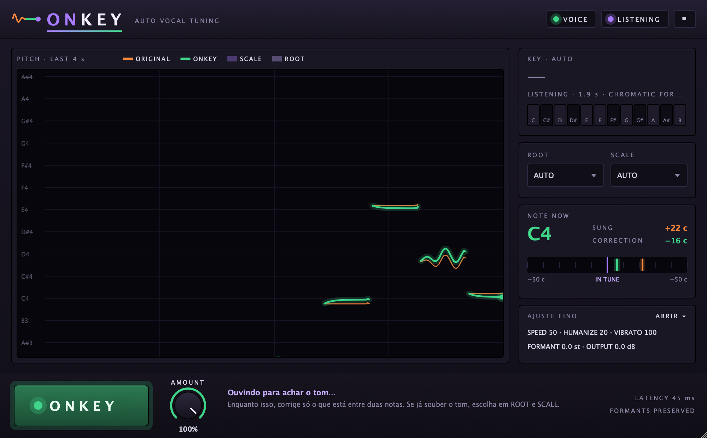
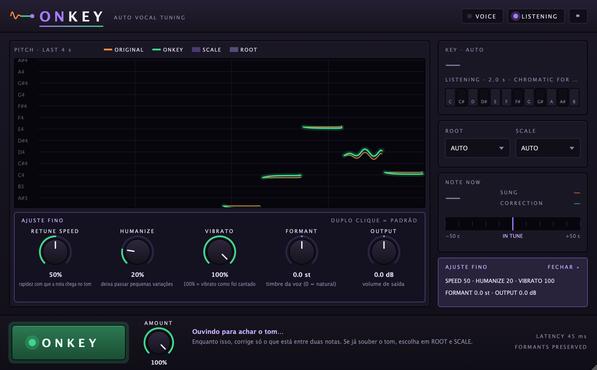

# ONKEY

> **Não é produto.** A 0.1.0 (06/11/2026) saiu só como TESTE, sem licença e fora do site. Em 15/11/2026 o motor do
> ONKEY virou o bloco **TUNE** do [GOGÓ](../gogo/README.md). Notas em [`novidades/Onkey.md`](../../novidades/Onkey.md).

Afinação automática de voz (VST3 / AU). Esta pasta guarda o plugin de teste e o motor de origem; quem usa o motor
hoje é o GOGÓ (`../gogo/Source/TuneDsp.h`, cópia igual do `Source/Dsp.h` daqui).

## O que o motor faz

- Vai no canal da VOZ (uma voz só). Acha sozinho o tom e a escala em alguns segundos de voz (perfis de
  Krumhansl-Kessler sobre as notas cantadas) e leva ao tom cada nota que sair dele. Enquanto o tom não trava, corrige
  só o que está entre duas notas (cromático). ROOT e SCALE escolhem o tom na mão (MAJOR, MINOR, HARM. MINOR,
  MAJ. PENTA, MIN. PENTA, CHROMATIC).
- Corrige pelo **centro** de cada nota: vibrato, slides e respiração passam como foram cantados. Consoantes e
  respiração saem idênticas à entrada.
- Síntese TD-PSOLA (um grão por período): os formantes ficam onde estavam, a voz não muda de timbre. Sem correção, a
  saída é a própria entrada, amostra por amostra.
- Latência de ~45 ms, compensada pelo DAW.

## Tela do plugin de teste

Botão ONKEY, AMOUNT, KEY (tom detectado e as 12 notas da escala), ROOT / SCALE, NOTE NOW (como foi cantado e a
correção, em cents) e o gráfico dos últimos 4 s com a voz original (laranja) e a corrigida (verde) sobre as faixas da
escala (roxo). O **AJUSTE FINO** abre por cima do gráfico: RETUNE SPEED, HUMANIZE, VIBRATO, FORMANT (±3 st) e OUTPUT.
No GOGÓ, esses ajustes estão nos AJUSTES do bloco TUNE.

## Código

- `Source/Dsp.h`: o motor (detecção, nota, tom, correção e síntese), em C++ puro (sem JUCE).
- `Source/PluginProcessor.cpp` e `Source/PluginEditor.cpp`: o plugin de teste.
- `tools/teste_dsp.cpp`: mede o motor com uma voz sintética (vogal "a", melodia em Dó maior cantada desafinada,
  vibrato, um slide, consoantes e silêncios): desligado e AMOUNT 0 idênticos à entrada atrasada, tom detectado, erro
  de afinação antes e depois, vibrato mantido, nível por nota, estalos e CPU.
  `zig c++ -O2 -std=c++17 -target x86_64-windows-gnu teste_dsp.cpp -o teste_dsp.exe && teste_dsp.exe`
