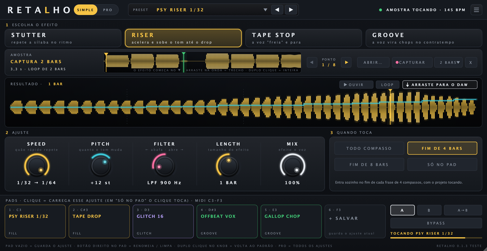
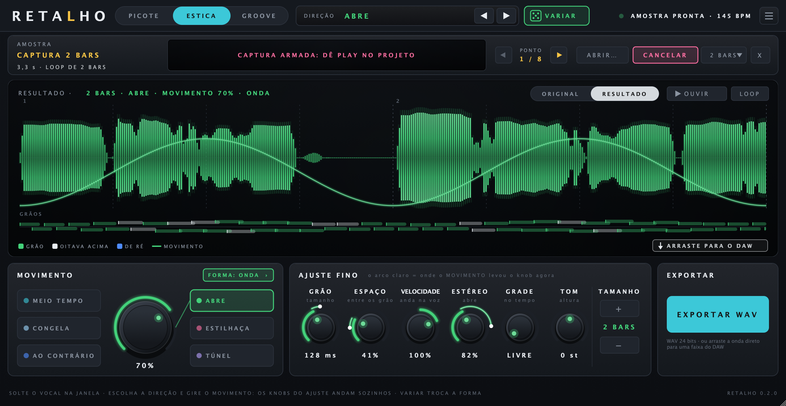
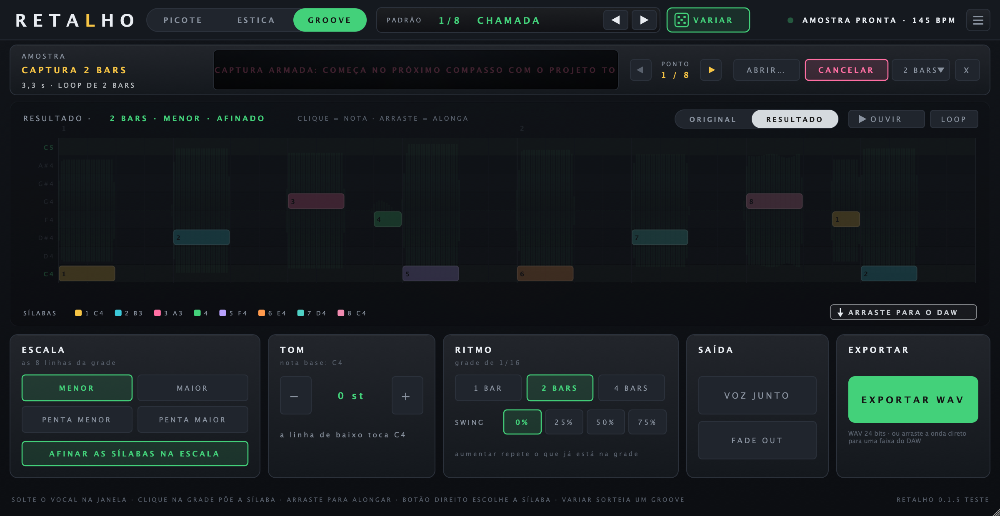

# RETALHO

> **Versão atual: 0.1.5** (17/11/2026) · TESTE aprovado, sem licença e ainda fora do site; lançamento previsto para
> 23/11/2026 · notas em [`novidades/Retalho.md`](../../novidades/Retalho.md)

Sampler de vocal (VST3 / AU). A voz fica DENTRO dele e vira picote, grão ou groove, em três modos: **PICOTE**,
**ESTICA** e **GROOVE**. Com o projeto tocando, o resultado toca em loop no tempo do projeto; quando ficar bom, exporte
o WAV ou arraste para uma faixa do DAW. Latência zero.

## Como usar

1. Ponha a voz dentro do RETALHO de um destes jeitos:
   - arraste o arquivo do vocal (WAV, AIFF, FLAC, MP3 ou OGG, até 60 s) para a janela;
   - **ABRIR…**;
   - ponha o plugin na faixa da voz e clique em **CAPTURAR**: ele grava 1, 2, 4 ou 8 compassos a partir do próximo
     compasso.
2. Com amostra carregada, a faixa original fica muda e a amostra toca em loop no tempo do projeto. Arraste na onda da
   amostra para escolher o trecho (duplo clique volta para ela inteira); X tira a amostra. Ela é salva dentro do
   projeto (FLAC): reabriu, está lá, mesmo se o arquivo sumir.
3. O efeito começa no primeiro ataque que soa (o ▼ âmbar na onda); **◀ PONTO ▶** troca para o ataque anterior ou o
   próximo.
4. Escolha o modo no topo (PICOTE | ESTICA | GROOVE). O resultado é refeito na hora a cada mudança, sem precisar dar
   play; **OUVIR** toca o ORIGINAL ou o RESULTADO, com LOOP.
5. **EXPORTAR WAV** (24 bits, em Documentos/RETALHO/Exports) ou arraste o botão **ARRASTE PARA O DAW** para uma faixa.

## PICOTE

A frase toca LIMPA e o efeito cai só em alguns pontos, no fim da frase e do compasso.

- **RECEITA ◀ ▶** (16 receitas) escolhe quais efeitos; **VARIAR** sorteia de novo onde eles caem.
- **QUANTO EFEITO**: POUCO, MÉDIO, MUITO ou **MANUAL** (só o que você marcar).
- Arraste na onda (ou clique num pedaço) e escolha o efeito daquele pedaço: LIMPA, REPETE, TOM, AO CONTRÁRIO, ACELERA,
  FREIA ou CORTE. Os pedaços marcados ganham uma quina branca e ficam salvos no projeto.
- **RITMO DAS REPETIÇÕES** (1/4, 1/8, 1/16, 1/32, MISTO), **TAMANHO** (de 1/2 até 16 BARS), **FADE OUT** e **ESTÉREO**.
- Na onda, cinza é voz limpa e cada efeito tem a sua cor.

## ESTICA

A voz vira grãos.

- **DIREÇÃO**: MEIO TEMPO, CONGELA, AO CONTRÁRIO, ABRE, ESTILHAÇA ou TÚNEL.
- **MOVIMENTO** (o knob grande) leva os knobs do **AJUSTE FINO** (GRÃO, ESPAÇO, VELOCIDADE, ESTÉREO, GRADE, TOM) pelo
  caminho da DIREÇÃO ao longo da frase, na **FORMA** escolhida (SOBE, SOBE E DESCE, DEGRAUS, ONDA, DESCE). O arco
  claro em cada knob mostra onde o movimento está agora, e a linha sobre a onda mostra o movimento na frase.
- **VARIAR** troca a forma e os grãos.
- Embaixo da onda aparece cada grão: em cima os da esquerda, embaixo os da direita.

## GROOVE

As sílabas da voz, do PONTO em diante, tocam numa grade de 1/16 que você programa.

- Cada linha da grade é uma nota da **ESCALA** (MENOR, MAIOR, PENTA MENOR, PENTA MAIOR). **AFINAR** mede a altura de
  cada sílaba e leva para a nota da linha.
- Clique para pôr, arraste para alongar, clique de novo para apagar; o botão direito escolhe a sílaba.
- 8 padrões prontos (◀ ▶), **VARIAR** sorteia um groove novo, **TOM** sobe ou desce tudo, **SWING**, 1/2/4 BARS e
  **VOZ JUNTO**.

## Código

- `Source/Dsp.h`: o motor dos três modos (PICOTE, ESTICA, GROOVE) e as listas da tela, em C++ puro (sem JUCE). O
  efeito é calculado numa linha própria, fora da tela.
- `Source/PluginProcessor.cpp`: a amostra (arquivo, CAPTURAR, FLAC salvo no projeto), o loop no tempo do projeto, o
  OUVIR e o EXPORTAR.
- `Source/PluginEditor.cpp`: a tela.
- `Source/Presets.h`: os presets de fábrica da tela antiga (o AVANÇADO saiu na 0.1.5).
- `tools/teste_dsp.cpp`: bancada (sem JUCE) com uma voz de teste de 16 sílabas.
  `g++ -O2 -std=c++17 tools/teste_dsp.cpp -o teste && ./teste`
